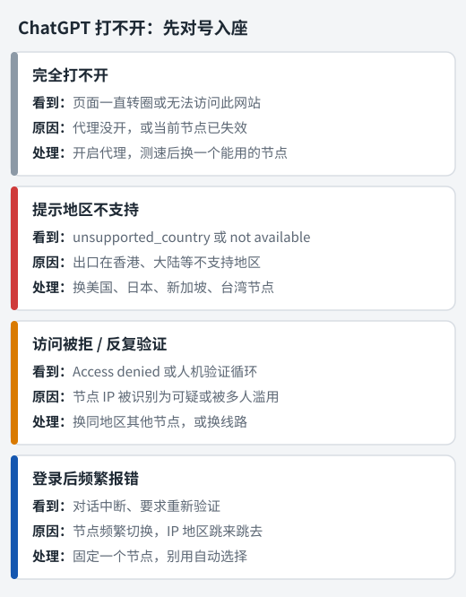

很多人第一次用 ChatGPT，都会遇到同一个问题：**代理明明开了，ChatGPT 还是打不开**，或者能打开却提示"所在地区不支持"。

其实 ChatGPT 打不开的情况就那么几种，每种原因都不一样。下面先帮你判断是哪一种，再按步骤解决。整个过程不需要任何技术基础，跟着做一般五分钟内就能搞定。

## 先对号入座：你遇到的是哪种情况

<figure>
  
  <figcaption>按你看到的提示找到对应的一行，再看下文的详细处理方法。</figcaption>
</figure>

| 你看到的 | 最可能的原因 | 跳到 |
| --- | --- | --- |
| 网页一直转圈、无法访问 | 代理没生效或节点失效 | [情况一](#情况一完全打不开) |
| 提示地区或国家不支持 | 节点出口在不支持的地区 | [情况二](#情况二提示地区不支持) |
| Access denied、无限人机验证 | 节点 IP 被识别为可疑 | [情况三](#情况三访问被拒或反复人机验证) |
| 能登录，但对话经常报错 | 节点频繁切换 | [情况四](#情况四登录后频繁报错或要求验证) |

## 第一步：查看 ChatGPT 看到的你在哪里

不管是哪种情况，先做这个检测，它能帮你排除一大半的猜测。

在开着代理的浏览器里打开：

```
https://chatgpt.com/cdn-cgi/trace
```

页面会显示几行文字，找到 `loc=` 这一行：

| loc= 后面 | 含义 | 能否使用 ChatGPT |
| --- | --- | --- |
| `US` `JP` `SG` `TW` 等 | 美国、日本、新加坡、台湾…… | 可以 |
| `HK` | 香港 | **不可以** |
| `CN` | 中国大陆，说明代理根本没生效 | **不可以** |

这个页面显示的就是 ChatGPT 服务器认为你所在的地区。显示 `HK` 或 `CN`，问题就找到了。如果页面本身打不开，说明当前节点连 ChatGPT 的服务器都连不上，属于情况一。

## 情况一：完全打不开

**表现**：网页一直加载，或者浏览器显示"无法访问此网站"。

**处理步骤**：

1. 确认代理已经开启：Clash 系列看系统代理开关，小火箭看顶部开关，v2rayN 看系统代理是否选了"自动配置系统代理"。
2. 在客户端里测一下延迟，换一个能连通的节点。
3. 仍然不行，就更新一次订阅，并到机场后台确认套餐没有过期、流量没有用完。

如果其他国外网站都能打开，唯独 ChatGPT 打不开，往往是规则把 ChatGPT 分到了"直连"。把代理模式临时切到"全局"试试，能打开就说明是规则问题，更新一下订阅或配置即可。

## 情况二：提示地区不支持

**表现**：页面提示所在国家或地区不支持，或者出现 `unsupported_country_region_territory` 之类的错误。

这是最常见的一种情况，原因也最集中：**你用的是香港节点**。

### 为什么香港节点不行

OpenAI 并不是所有地区都提供服务。中国大陆、香港、澳门目前都不在支持范围内。而香港节点离内地近、速度快，几乎是所有机场节点列表里排在最前面的，很多人默认就选了它。

所以只要换到支持地区的节点，大部分"地区不支持"的问题就解决了。

### 该选哪个地区的节点

| 地区 | 特点 |
| --- | --- |
| 美国 | 支持度最好，但离得远，延迟较高 |
| 日本 | 延迟低、速度快，日常使用体验好 |
| 新加坡 | 延迟适中，比较稳定 |
| 台湾 | 离得近，速度快 |

支持地区的名单会调整，具体以 OpenAI 帮助中心公布的列表为准。

换好节点后，**刷新一下 ChatGPT 页面**，必要时清除一下这个网站的 Cookie 再进，避免浏览器缓存了之前的地区判断。

## 情况三：访问被拒或反复人机验证

**表现**：页面显示 Access denied，或者人机验证做完一次又来一次，怎么都进不去。

**原因**：ChatGPT 前面有一层安全防护，会给每个 IP 打分。机场节点多是机房 IP，而且一个 IP 同时有很多人在用，如果其中有人滥用，整个 IP 的信誉就会变差，被要求反复验证甚至直接拒绝访问。

**处理步骤**：

1. 换一个**同地区的其他节点**，比如从"日本 01"换到"日本 03"。
2. 换一条线路或换一个支持地区再试。
3. 如果一个机场的所有支持地区节点都是这样，说明这家机场的 IP 整体质量不适合用 ChatGPT，可以考虑换一家专门标注支持 ChatGPT 的机场。

## 情况四：登录后频繁报错或要求验证

**表现**：能正常登录，但对话经常中断、提示出错，或者隔一会儿就要求重新验证身份。

**原因**：多半是你用了"自动选择""故障转移"这类分组。它们会按延迟自动切换节点，IP 地址可能在日本、新加坡、甚至香港之间跳来跳去。对 ChatGPT 来说，这看起来像是同一个账号在短时间内出现在好几个国家，自然会提高警惕。

**处理步骤**：手动选定一个支持地区的节点，并且**固定使用它**，不要让客户端自动切换。

## 在客户端里给 ChatGPT 固定节点

最理想的状态是：日常上网仍然用速度最快的香港节点，只有 ChatGPT 走日本或美国节点。能不能做到，取决于机场的订阅里有没有专门的分组。

### Clash Verge Rev / Clash Meta for Android

打开 **代理** 页面，看看有没有名字类似 **OpenAI**、**ChatGPT** 或 **AI** 的策略组。

- **有**：在这个策略组里选一个美国、日本或新加坡节点就行。其他网站不受影响。
- **没有**：只能在主分组（通常叫"节点选择"）里直接选一个支持地区的节点。这样所有国外流量都会走这个节点，速度可能稍慢，但最简单可靠。

### Shadowrocket（小火箭）

如果机场提供了带策略组的配置文件，在 **配置** 里使用它，然后在首页的策略组里给 ChatGPT 对应的分组选节点。

如果只用了默认配置，就在首页直接选一个支持地区的节点，全局路由保持"配置"即可。

### v2rayN

v2rayN 同一时间只用一个活动节点，所以直接把活动节点设成美国、日本、新加坡或台湾节点就行，路由保持"绕过大陆"。

客户端的基本操作不熟悉的话，可以先看对应教程：[Clash Verge Rev](/jiaocheng/clash-verge-rev-jiaocheng/)、[Clash Meta for Android](/jiaocheng/clash-meta-for-android-jiaocheng/)、[Shadowrocket](/jiaocheng/shadowrocket-jiaocheng/)、[v2rayN](/jiaocheng/v2rayn-jiaocheng/)。

## 手机上用 ChatGPT

- **网页版**：手机浏览器打开 chatgpt.com 就能用，和电脑一样，按上面的方法选好节点即可。
- **iPhone App**：国区 App Store 搜不到，需要用外区 Apple ID 下载（注册方法见[外区 Apple ID 注册教程](/jiaocheng/waiqu-apple-id-zhuce/)）。用小火箭的人本来就有外区账号，直接搜索 ChatGPT 安装，认准开发者是 OpenAI。
- **安卓 App**：国内应用商店没有，可以通过 Google Play 安装。

App 和网页版遇到的问题一样，排查方法也一样：先确认节点地区。

## 关于账号安全，提前了解这几点

- **OpenAI 的服务条款规定，用户应在其支持的地区使用服务。** 通过代理从不支持的地区访问，存在账号被限制的可能。这一点要心里有数。
- **固定使用一个地区。** 账号注册、日常使用、付费订阅尽量都在同一个地区的节点下完成，不要今天美国、明天日本。
- **不要使用别人共享的账号。** 多人在不同地方同时登录同一个账号，是最容易触发风控的行为。

## 选机场时怎么判断适不适合用 ChatGPT

如果你买机场的主要目的就是用 ChatGPT，购买前可以留意这几点：

1. **有没有美国、日本、新加坡、台湾节点**，而且不止一两个。
2. **订阅里有没有单独的 AI 或 OpenAI 策略组**，有的话说明机场专门做了适配。
3. **官网或节点名称有没有标注支持 ChatGPT**。
4. **有没有免费试用或短期套餐**。买之前先用上面的 `chatgpt.com/cdn-cgi/trace` 方法实际测一下，比看宣传可靠得多。

想看我们整理的机场，可以去[机场推荐榜单](/jichang-tuijian/)。

## 小结

ChatGPT 打不开，九成以上是节点地区的问题。记住三件事：

1. 用 `chatgpt.com/cdn-cgi/trace` 看 `loc=`，**不能是 HK 或 CN**；
2. 选美国、日本、新加坡、台湾等支持地区的节点；
3. **固定一个节点**，别让客户端自动切换。

看 Netflix、Disney+ 遇到类似问题，可以接着看[流媒体解锁教程](/jiaocheng/liumeiti-jiesuo/)。
