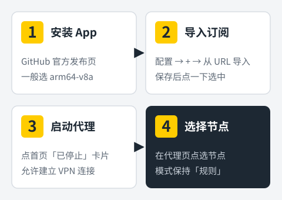
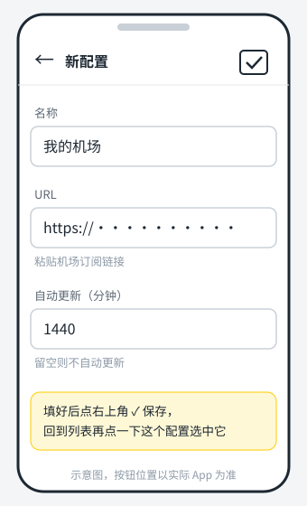
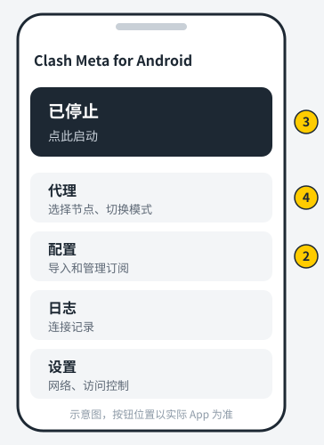
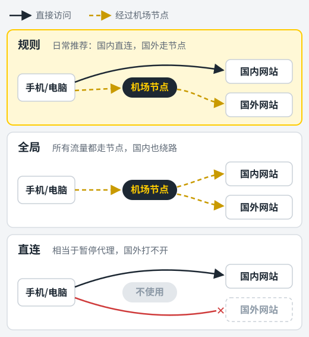

安卓手机上用机场，目前最主流的客户端是 **Clash Meta for Android**，常被简称为 CMFA。它是开源免费的，内核是 Mihomo（也就是以前的 Clash Meta），对新协议支持得很好，几乎所有机场的 Clash 订阅都能直接用。

整个使用流程可以概括为四步：**装好 App → 导入订阅 → 点启动 → 选节点**。下面每一步都写了具体点哪里，以及容易出错的地方。

<figure>
  
  <figcaption>整个流程分四步，下面逐步展开。</figcaption>
</figure>

## 准备工作

- **一部安卓手机**，系统版本不要太旧。
- **一份机场订阅链接**，在机场后台获取，优先选 Clash 格式。没有机场的话可以参考[机场推荐榜单](/jichang-tuijian/)。

## 第一步：下载正确的安装包

### 只从官方渠道下载

Clash Meta for Android 由 MetaCubeX 团队在 GitHub 上发布，项目名是 `ClashMetaForAndroid`。请从这个项目的 **Releases** 页面下载。网上流传的"汉化版""破解版"没有任何必要，这个软件本身就是免费且自带中文的，来路不明的安装包反而可能被动过手脚。

Google Play 商店里同名或相似名字的应用，很多并不是官方发布的，不建议从那里装。

### 选对文件

Releases 页面里每个版本会列出好几个 APK 文件，区别在于适配的处理器架构：

| 文件名中包含 | 适用于 |
| --- | --- |
| `arm64-v8a` | 近几年的绝大多数手机，**一般选这个** |
| `armeabi-v7a` | 很老的 32 位手机 |
| `x86_64` / `x86` | 电脑上的安卓模拟器 |
| `universal` | 通用版，所有设备都能装，体积最大 |

另外，页面上标注为 **Pre-release** 或文件名里带 `alpha` 的是测试版，新功能多但可能不稳定。日常使用选标注为正式版（Latest）的那一个。

### 安装

下载完成后点开 APK。第一次从浏览器安装应用时，系统会提示"禁止安装未知来源应用"，按提示进入设置，允许当前浏览器安装应用，再返回继续安装即可。

<!-- 截图建议：GitHub Releases 页面，圈出 arm64-v8a 文件 -->

## 第二步：导入机场订阅

1. 打开 Clash Meta for Android，点首页的 **配置**。
2. 点右上角的 **+** 号，选择 **从 URL 导入**。
3. 填写三项内容：
   - **名称**：随便起，比如机场名字。
   - **URL**：粘贴订阅链接。
   - **自动更新**：填一个分钟数，例如 `1440` 表示每天自动更新一次，留空则不自动更新。
4. 点右上角的 **保存** 图标，App 会立即下载订阅。
5. 下载完成后回到配置列表，**点一下刚才这个配置，让它左侧出现选中标记**。

第 5 步经常被忽略。配置列表里可以有多份订阅，只有被选中的那份才会生效。

<figure>
  
  <figcaption>「从 URL 导入」页面：填好三项后点右上角保存。</figcaption>
</figure>

<!-- 截图建议：从 URL 导入的填写界面，订阅链接打码（拿到真实截图后替换上面的示意图） -->

> 订阅链接里包含你的账号信息，别发到群里，求助截图时记得打码。

### 手动更新订阅

机场更换节点后，回到 **配置** 页，点订阅右侧的菜单按钮，选择 **更新** 即可立即拉取最新内容。

## 第三步：启动代理

回到首页，最上方有一张显示 **已停止** 的卡片，点它一下。

第一次启动时，系统会弹出"网络连接请求"，说明这个应用要建立 VPN 连接，点 **确定**。这是所有安卓代理工具的正常流程，Clash Meta for Android 通过系统的 VPN 接口来接管手机流量。

卡片变成 **运行中** 之后，通知栏会出现常驻通知，状态栏也会有一个钥匙形状的 VPN 图标。

<figure>
  
  <figcaption>首页各入口对应本文的步骤：② 配置　③ 启动卡片　④ 代理</figcaption>
</figure>

<!-- 截图建议：首页运行中状态（拿到真实截图后替换上面的示意图） -->

## 第四步：选择节点

点首页的 **代理**，进入节点页面。

- 顶部的标签是机场设定的 **策略组**，例如"节点选择""自动选择""流媒体"等，每家机场命名不同。
- 点右上角的 **闪电图标** 可以测试当前组里所有节点的延迟。
- 在 **节点选择**（或机场命名的同类主分组）里点一个节点即可切换，被选中的节点会高亮显示。

"自动选择"这类分组会定期测速，自动用当前延迟最低的节点，懒得手动挑的话把主分组设为它就行。

### 代理模式：保持"规则"

在代理页面右上角的菜单里可以切换模式：

| 模式 | 效果 |
| --- | --- |
| 规则 | 按订阅里的规则分流，国内直连、国外走代理，**日常用这个** |
| 全局 | 所有流量都走所选节点 |
| 直连 | 不走代理 |

<figure>
  
  <figcaption>三种模式的区别：只有「规则」能做到国内直连、国外走节点。</figcaption>
</figure>

用"规则"模式，国内 App 的速度不受影响，也不会白白消耗机场流量。只有某个国外网站打不开、怀疑规则没覆盖到时，才临时切到"全局"测试一下。

## 进阶：分应用代理

有时候你只想让少数几个 App 走代理，或者想把银行、支付类 App 完全排除在外，就要用到 **访问控制**。

1. 进入 **设置 → 网络 → 访问控制模式**。
2. 选择一种模式：
   - **允许所有应用**：默认值，所有 App 都经过 Clash，再由规则决定直连还是代理。
   - **仅允许已选择的应用**：只有勾选的 App 走 Clash，适合只给浏览器、YouTube 等少数应用用代理。
   - **不允许已选择的应用**：勾选的 App 完全绕过 Clash，适合排除银行、网约车等对 IP 敏感的国内应用。
3. 在下方的应用列表里勾选对应 App。

修改访问控制后，需要回到首页 **先停止再重新启动** 才会生效。

对大多数人来说，保持"允许所有应用"加"规则"模式就足够了。只有遇到某个国内 App 在代理开启时报错，再把它加入排除名单。

## 让代理在后台不被杀掉

很多国产安卓系统的省电策略比较激进，锁屏一会儿就会把后台应用清掉，表现就是代理莫名其妙断了。建议做这几项设置（不同品牌名称略有差异）：

- **关闭电池优化**：在系统设置的电池或应用管理中，找到 Clash Meta for Android，设为"不优化"或"无限制"。
- **允许自启动和后台运行**：在应用详情页的权限或耗电管理里打开。
- **锁定后台**：打开最近任务界面，下拉或长按 Clash 的卡片，选择锁定，防止一键清理时被关掉。

## 常见问题排查

**导入订阅时报错或一直转圈**
订阅链接可能复制不完整，重新复制一次。如果当前网络无法访问订阅地址，换成另一个网络再导入，或者使用机场提供的备用订阅地址。

**启动后所有节点测速都超时**
先更新一次订阅；再去机场后台确认套餐是否到期、流量是否用完；最后检查手机时间是否准确，时间偏差过大也会导致部分协议连接失败。

**能打开网页，但看视频很卡**
换一个地区或换一条线路的节点。晚高峰时段热门地区的节点容易拥挤，可以多试几个。

**某些 App 提示网络错误**
先把模式切到"直连"看看能否恢复，能恢复说明和代理有关。把这个 App 加入访问控制的排除列表即可。

## 小结

记住三件事就能用好 Clash Meta for Android：**订阅导入后要点选中、首页点卡片启动、代理模式保持"规则"**。再把电池优化关掉，基本就能做到一直在线。

iPhone 用户请看 [Shadowrocket 小火箭使用教程](/jiaocheng/shadowrocket-jiaocheng/)，电脑用户请看 [Clash Verge Rev 使用教程](/jiaocheng/clash-verge-rev-jiaocheng/) 或 [v2rayN 使用教程](/jiaocheng/v2rayn-jiaocheng/)。
