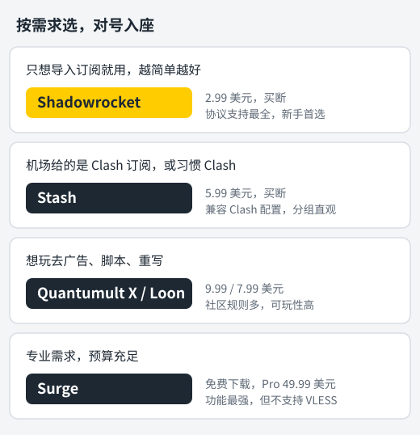

在 iPhone 上用机场，必须先选一个代理客户端。国区 App Store 没有这类应用，所以都需要用外区 Apple ID 购买，而且大多是付费的。买错了虽然钱不多，但很浪费时间。

这篇文章把目前最常见的五款放在一起比较：**Shadowrocket（小火箭）、Quantumult X（圈X）、Loon、Stash、Surge**。先说结论，再看细节。

## 先说结论

<figure>
  
  <figcaption>按自己的需求找到对应的一行就行。价格为美区 App Store 价格，以实际页面为准。</figcaption>
</figure>

- **九成的人买小火箭就够了。** 便宜、协议最全、导入订阅最省事。
- **机场主推 Clash 订阅**，或者你在电脑上已经习惯了 Clash，可以选 **Stash**。
- **喜欢折腾去广告、脚本、重写规则**，选 **Quantumult X** 或 **Loon**。
- **Surge** 功能最强也最贵，适合有专业需求的人，普通用户没必要。

## 价格和收费方式

下面是 2026 年 11 月美区 App Store 的价格，其他地区会有差别，购买前以 App Store 页面为准。

| 客户端 | 价格 | 收费方式 |
| --- | --- | --- |
| Shadowrocket（小火箭） | 2.99 美元 | 一次买断 |
| Stash | 5.99 美元 | 一次买断 |
| Loon | 7.99 美元 | 一次买断 |
| Quantumult X（圈X） | 9.99 美元 | 一次买断 |
| Surge | 免费下载，Pro 授权 49.99 美元 | 授权买断，另有功能订阅 |

前四款都是买一次一直用，后续更新也不另外收费。Surge 的收费方式不同：下载免费，但要用完整功能需要买 Pro 授权，新功能还另有订阅选项。

没有外区信用卡的话，可以用对应地区的 App Store 礼品卡充值后购买。注册外区账号的方法见[外区 Apple ID 注册教程](/jiaocheng/waiqu-apple-id-zhuce/)。

## 这五款有免费版吗？

先说答案：**五款都没有可以长期免费使用的正式版。** 逐个来看：

| 客户端 | 有没有免费版 | 说明 |
| --- | --- | --- |
| Shadowrocket（小火箭） | 没有 | 只有 2.99 美元买断版 |
| Quantumult X（圈X） | 没有 | 只有 9.99 美元买断版 |
| Stash | 没有 | 只有 5.99 美元买断版 |
| Loon | 没有，但有便宜的精简版 | 同一开发者出了 **Loon Lite**，美区 0.99 美元 |
| Surge | 可以免费下载 | 完整功能需要购买 Pro 授权，免费下载不等于能长期免费用 |

**关于 Loon Lite**：它是五款相关应用里门槛最低的一个。和标准版 Loon 的功能差别，以它在 App Store 页面上的说明为准，买之前看一眼，确认支持你机场的协议。

### 网上的"免费下载"能用吗

搜索"小火箭免费下载""圈X 免费"，会看到不少所谓的免费方法。常见的有三种，都不建议用：

1. **共享账号**：有人公开分享已经买过这些应用的外区 Apple ID，让你登录后免费下载。账号主人随时可能改密码，你下载的应用就没法更新；如果误把共享账号登录到 iCloud，对方开启"查找"后还能远程锁定你的手机。
2. **破解版、自签安装包**：通过非 App Store 渠道安装的修改版。代理软件会经手你所有的网络流量，包括各种账号密码和支付信息，来路不明的修改版是最大的安全隐患。
3. **"送小火箭"的机场或网站**：大多数也是让你登录共享账号，风险和第一种一样。

为了省两三美元，承担手机被锁、信息泄露的风险，很不划算。

### 想省钱，可以这样做

- **先确定会长期用，再买客户端。** 可以先找有免费试用的机场，确认真的需要，再花钱。
- **从最便宜的开始。** 小火箭 2.99 美元已经能满足绝大多数需求，没必要一上来就买贵的。
- **用家人共享。** 部分买断制应用支持苹果的"家人共享"，家里只需要买一次，具体以 App Store 页面是否显示支持为准。
- **换手机不用重买。** 用购买时的外区 Apple ID 登录，就能免费重新下载。

## 协议支持：先看你的机场用什么

**客户端不支持机场的协议，就算导入订阅也连不上。** 这是选客户端时最该先确认的一点。

机场常用的协议，在各客户端的支持情况如下（根据各应用 App Store 官方说明整理，2026 年 11 月）：

| 协议 | 小火箭 | Quantumult X | Loon | Stash | Surge |
| --- | --- | --- | --- | --- | --- |
| Shadowsocks | ✓ | ✓ | ✓ | ✓ | ✓ |
| VMess | ✓ | ✓ | ✓ | ✓ | ✓ |
| Trojan | ✓ | ✓ | ✓ | ✓ | ✓ |
| VLESS（含 Reality） | ✓ | ✓ | ✓ | ✓ | ✗ |
| Hysteria2 | ✓ | ✗ | ✓ | ✓ | ✓ |
| TUIC | ✓ | ✗ | 未列出 | ✓ | ✓ |
| WireGuard | ✓ | 未列出 | ✓ | ✓ | ✓ |

从表里可以看出两个要注意的地方：

- **Quantumult X 不支持 Hysteria2。** 越来越多机场用 Hysteria2 做高速节点，买圈X之前要先确认。
- **Surge 不支持 VLESS。** 而 VLESS Reality 是现在很多机场的主力协议，花 50 美元买了却连不上主力节点，就很尴尬。

**怎么知道机场用的是什么协议？** 看机场后台的节点列表或使用说明，一般会写明。也可以导入订阅后看节点详情。

## 订阅格式：能不能一键导入

机场通常会提供好几种格式的订阅链接，名字一般就叫"Clash 订阅""小火箭订阅""Surge 订阅"等。

| 客户端 | 主要订阅格式 | 说明 |
| --- | --- | --- |
| 小火箭 | 通用订阅、Clash 订阅 | 兼容性最好，几乎什么链接都能导入 |
| Stash | Clash 订阅 | 兼容 Clash 配置标准，策略组和规则原样可用 |
| Loon | Loon 格式、通用订阅 | 多数机场提供 Loon 专用订阅 |
| Quantumult X | 圈X 格式 | 需要机场提供圈X订阅，或借助资源解析器转换 |
| Surge | Surge 格式 | 需要机场提供 Surge 托管配置 |

**简单判断方法**：打开机场后台，看"一键导入"按钮里有哪些客户端。有对应按钮的，导入就最省事。

## 五款客户端逐个看

### Shadowrocket（小火箭）：最适合新手

**优点**

- 价格最低，2.99 美元买断。
- 协议支持最全，新协议跟进也快。
- 订阅兼容性最好，通用订阅、Clash 订阅都能导入。
- 界面简单：导入订阅、选节点、打开开关，三步就能用。

**缺点**

- 高级功能（规则、重写、脚本）有，但不如圈X、Loon 那样有大量现成的社区资源。
- 界面比较朴素。

**适合谁**：绝大多数只想稳定翻墙的用户。具体用法见 [Shadowrocket 小火箭教程](/jiaocheng/shadowrocket-jiaocheng/)。

### Stash：Clash 用户的 iPhone 版

**优点**

- 兼容 Clash 配置标准。机场的 Clash 订阅导入后，策略组、分流规则和电脑上的 Clash 一模一样。
- 策略组展示直观。机场配置里如果有"流媒体""AI"等分组，在 Stash 里切换节点很方便。
- 协议支持全面，VLESS Reality、Hysteria2、TUIC 都支持。

**缺点**

- 比小火箭贵一倍。
- 主要围绕 Clash 格式，非 Clash 订阅用起来不如小火箭灵活。

**适合谁**：电脑上已经在用 [Clash Verge Rev](/jiaocheng/clash-verge-rev-jiaocheng/)，希望手机和电脑使用同一套订阅和分组的人。

### Quantumult X（圈X）：去广告与脚本玩家

**优点**

- 重写、脚本、MitM 等高级功能强大，社区里有大量现成的去广告规则和脚本。
- 可玩性很高，喜欢研究的人能玩出很多花样。

**缺点**

- 五款里买断价最高，9.99 美元。
- **不支持 Hysteria2 和 TUIC。**
- 配置语法自成一套，订阅需要机场提供圈X格式，新手上手门槛较高。

**适合谁**：喜欢折腾、想在 iPhone 上去广告，并且确认机场节点没有 Hysteria2 的用户。

### Loon：功能与易用的平衡

**优点**

- 支持插件，可以一键导入社区制作的去广告、功能增强插件，比手写规则简单。
- 协议支持较全，VLESS Reality、Hysteria2 都支持。
- 很多机场提供 Loon 专用订阅。

**缺点**

- 价格比小火箭高不少。
- 功能多，界面选项也多，刚开始需要花点时间熟悉。

**适合谁**：想要圈X那样的高级玩法，但又希望操作更简单、协议支持更全的人。

### Surge：专业工具

**优点**

- 功能最强大、最完整，网络调试、请求查看、增强模式等专业功能丰富。
- 稳定性和性能口碑很好。

**缺点**

- 最贵，Pro 授权 49.99 美元，另有功能订阅。
- **不支持 VLESS**，不少机场的主力节点用不了。
- 很多功能是给开发者和网络调试准备的，普通用户用不上。

**适合谁**：开发者、网络工程师，或者明确知道自己需要哪些专业功能、预算充足的人。

## 常见疑问

### 可以同时装好几个吗？

可以，但同一时间只能有一个开启代理。iPhone 的 VPN 配置一次只生效一个，打开 A 会自动断开 B。

### 换手机后要重新买吗？

不用。用购买时的外区 Apple ID 登录 App Store，就能免费重新下载。

### 买了之后连不上怎么办？

先别急着怀疑客户端。按顺序检查：订阅有没有导入成功、节点协议是不是这款客户端支持的、机场套餐有没有过期。大部分问题都出在这几步。

## 小结

- **不知道选什么，就买小火箭。** 便宜、协议最全、最好上手。
- **买之前先确认机场用的协议**：用 Hysteria2 的别选圈X，用 VLESS 的别选 Surge。
- **看机场后台的"一键导入"按钮**，有对应客户端的按钮就最省事。

还没有外区账号？先看[外区 Apple ID 注册教程](/jiaocheng/waiqu-apple-id-zhuce/)。已经有了客户端但还没有机场，可以看看[机场推荐榜单](/jichang-tuijian/)。

还没有机场？可以看 [小火箭机场推荐](/xiaohuojian-jichang/)：按 iPhone 的用量整理了该买多大的套餐，订阅都能直接导入小火箭。
