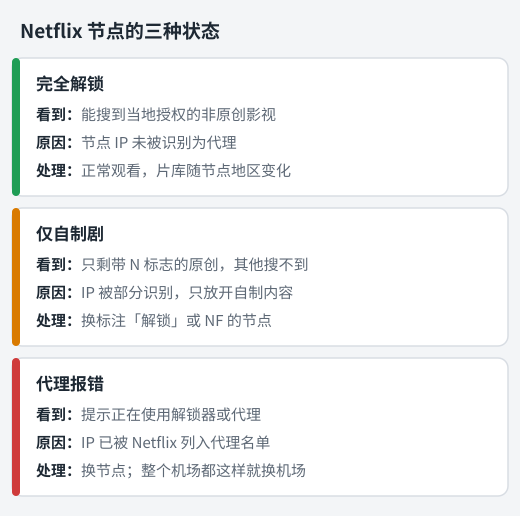

用机场看 Netflix，最让人头疼的不是连不上，而是**明明连上了，却只能看几部 Netflix 自制剧**，或者直接弹出"您似乎在使用代理"的提示。

这篇文章先用三分钟讲清楚"解锁"到底是怎么回事，然后教你自己判断节点的状态，最后讲在客户端里怎么把看视频的流量固定到合适的节点。Netflix、Disney+、YouTube 的常见问题都会讲到。

## 流媒体"解锁"是什么意思

Netflix、Disney+ 这些平台按国家和地区购买影视版权，所以每个地区能看的内容不一样。为了执行版权限制，平台会检查你的 **IP 地址** 来判断你在哪里。

用机场看流媒体，平台看到的是机场节点的出口 IP。这时会出现两个问题：

1. **这个 IP 在哪个国家**：决定你能看到哪个地区的片库。
2. **这个 IP 像不像代理**：如果平台认定它是代理或机房地址，就会限制内容，甚至直接拒绝播放。

所谓"解锁"，就是节点的 IP 能被平台当作正常的当地用户对待。

### 原生 IP、广播 IP 和机房 IP

在机场的介绍里，你可能会看到这几个词：

| 名词 | 意思 | 对流媒体的影响 |
| --- | --- | --- |
| 原生 IP | IP 登记的国家和服务器所在的国家一致 | 地区判断准确，解锁成功率较高 |
| 广播 IP | IP 登记在甲地，服务器却在乙地 | 有时会被判断成错误的地区 |
| 机房 IP | 来自数据中心而不是家庭宽带 | 更容易被识别为代理 |
| 家宽 IP | 来自当地的家庭宽带 | 最像普通用户，但机场里少见且贵 |

这也解释了一个常见现象：**同一家机场，不同节点的解锁情况可以完全不同**。所以判断要以节点为单位，而不是以机场为单位。

## Netflix：判断节点是哪种状态

<figure>
  
  <figcaption>同一个机场里，三种状态的节点可能同时存在。</figcaption>
</figure>

### 状态一：完全解锁

能看到当地授权的全部内容，包括其他公司出品的电影和剧集。这是最理想的状态。

### 状态二：仅自制剧

能登录、能播放，但片库明显变少，基本只剩带红色 **N** 标志的 Netflix 原创内容，搜索其他公司出品的热门影视搜不到。

这说明 Netflix 对这个 IP 起了疑心，只放开了它自己有全球版权的自制内容。

### 状态三：代理报错

播放时直接提示，大意是"您似乎在使用解锁器或代理服务器，请关闭后重试"。英文界面显示为 *You seem to be using an unblocker or proxy*，有时还会带一串以 `M7111` 开头的错误代码。

这说明当前 IP 已经被 Netflix 认定为代理。**和你的账号无关，不会因此封号**，换节点即可。

### 自己动手测一测

1. 选一个节点，打开 Netflix 网页版或 App。
2. 搜索三五部**不是 Netflix 出品**的热门老电影或老剧集。
3. 能搜到并播放 → 完全解锁；搜不到、只剩原创 → 仅自制剧；弹出代理提示 → 被识别。
4. 换下一个节点重复，把能完全解锁的节点记下来。

小提示：每个地区的片库本来就不一样，某部作品搜不到也可能只是这个地区没有版权。多搜几部，看整体情况来判断。

### 想看其他地区的片库

Netflix 显示的片库，取决于节点出口所在的国家。想看日本动画多的日本片库，就用能解锁的日本节点；想看美国片库，就用美国节点。切换节点后，**退出 App 重新打开**，或者刷新网页，片库才会更新。

## Disney+：先确认地区是否开通

Disney+ 不是所有地区都提供服务。如果出现"该服务在你所在的地区不可用"之类的提示，按这个顺序检查：

1. **节点所在地区有没有开通 Disney+**。美国、日本、新加坡、台湾、香港等地区都有服务，中国大陆没有。
2. **节点 IP 有没有被识别为代理**。地区没问题但仍然无法播放，就换同地区的其他节点。
3. **账号注册地区和节点地区是否差太远**。部分功能和内容和账号地区有关，尽量用同一个地区的节点登录和观看。

## YouTube：能看，但要留意"送中"

YouTube 对代理基本没有限制，大多数节点都能直接看。需要注意的是一种叫 **"送中"** 的情况：Google 把节点的 IP 误判成了中国大陆。

**怎么判断**：打开 YouTube 首页，看左上角 YouTube 标志旁边的小字母。它会显示 Google 认为你所在的地区，例如 `HK`、`JP`（美国地区不显示）。如果显示 `CN`，就是被"送中"了。

**常见表现**：

- YouTube Premium 提示在你所在地区不可用；
- 部分视频提示在你所在国家或地区无法观看；
- Google 的其他服务也可能出现异常。

**处理方法**：换一个节点即可。如果某个节点长期这样，可以把节点名称反馈给机场客服，他们一般会处理。

## 在客户端里固定流媒体节点

找到能解锁的节点后，下一步是让看视频的流量固定走它，而不影响其他网站。

### Clash Verge Rev / Clash Meta for Android

打开 **代理** 页面，找找有没有名字类似 **流媒体**、**Netflix**、**Disney**、**YouTube** 的策略组。

- **有**：在对应的策略组里选你测出来能解锁的节点。比如在"Netflix"分组里选"新加坡 解锁 02"，日常上网的主节点不受影响。
- **没有**：只能在主分组里直接选能解锁的节点。

### Shadowrocket（小火箭）

如果机场提供了带策略组的专用配置，在 **配置** 页使用它，然后在首页给流媒体相关的策略组选节点。只用默认配置的话，看视频时在首页直接切到能解锁的节点。

### v2rayN

v2rayN 同时只用一个活动节点。看视频前把活动节点换成能解锁的节点，路由保持"绕过大陆"即可。

各客户端的基本操作见：[Clash Verge Rev](/jiaocheng/clash-verge-rev-jiaocheng/)、[Clash Meta for Android](/jiaocheng/clash-meta-for-android-jiaocheng/)、[Shadowrocket](/jiaocheng/shadowrocket-jiaocheng/)、[v2rayN](/jiaocheng/v2rayn-jiaocheng/)。

## 能播放但很卡：这是速度问题

解锁和速度是两回事。能播放说明已经解锁，卡顿、频繁降画质是节点速度或稳定性不够。可以这样改善：

1. **在能解锁的节点里挑延迟最低的**，离你近的地区（香港、台湾、日本、新加坡）通常更快。
2. **避开晚高峰拥挤的节点**。晚上 8 点到 11 点卡，白天流畅，就是拥堵问题，换个人少的节点试试。
3. **临时降低画质**，先把 4K 调到 1080p 看是否改善。
4. **注意节点倍率**。流媒体节点倍率可能较高，看 4K 很费流量，留意套餐余量。

## 选机场时怎么判断流媒体能力

如果看流媒体是你的主要需求，购买前留意这几点：

1. **节点名称或官网是否标注解锁**，例如"Netflix""NF""Disney+""流媒体"。
2. **能解锁的节点是不是覆盖多个地区**，只有一两个解锁节点的话，一旦被封就没得换。
3. **订阅里有没有专门的流媒体策略组**，有的话设置起来方便很多。
4. **线路类型**。看高清视频，晚高峰稳定性比价格更重要，中转和专线机场通常比直连更合适。
5. **先试用再购买**。用上面的"自己动手测一测"方法，十几分钟就能知道是否适合你。

我们整理的机场见[机场推荐榜单](/jichang-tuijian/)。

## 小结

- 流媒体看的是**节点的出口 IP**，所以要以节点为单位判断，不是以机场为单位。
- Netflix 有三种状态：**完全解锁、仅自制剧、代理报错**。后两种换节点就行，与账号无关。
- Disney+ 先确认节点所在地区有没有开通服务；YouTube 留意标志旁有没有显示 `CN`。
- 找到能解锁的节点后，用策略组把视频流量固定过去。

ChatGPT 也打不开的话，可以接着看 [ChatGPT 打不开怎么办](/jiaocheng/chatgpt-da-bu-kai/)。
