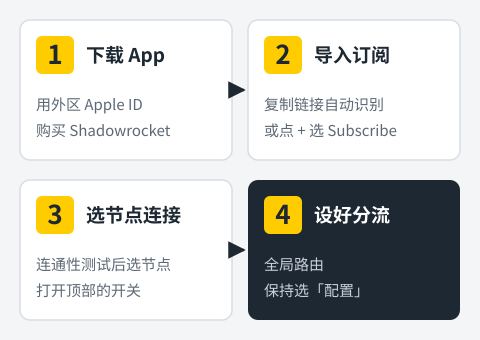
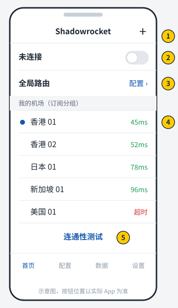
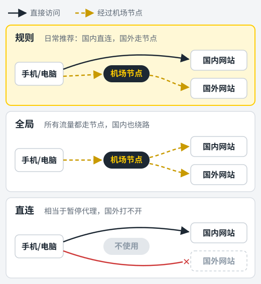

在 iPhone 上用机场，最常见的选择就是 Shadowrocket，国内用户习惯叫它"小火箭"。它界面简单、支持的协议多、导入订阅只要几秒钟，而且是买断制，花一次钱以后都能用。

这篇教程按实际操作顺序来写：**拿到软件 → 导入订阅 → 选节点连接 → 调整分流 → 处理常见问题**。第一次用的话，跟着从头做一遍大约十分钟。

<figure>
  
  <figcaption>整个流程分四步，下面逐步展开。</figcaption>
</figure>

## 开始之前要准备什么

- **一台 iPhone 或 iPad**，系统版本不要太老，能正常访问 App Store 即可。
- **一个外区 Apple ID**：美国、香港、台湾、日本等地区都可以。国区商店里没有这个应用。
- **一份机场订阅链接**：在你购买的机场后台里可以找到。还没有机场的话，可以先看看[机场推荐榜单](/jichang-tuijian/)。

## 第一步：用外区 Apple ID 下载 Shadowrocket

### 切换 App Store 账号

打开 **App Store**，点右上角的头像，滑到最底部点 **退出登录**，然后用外区 Apple ID 登录。

这里要特别注意：**只在 App Store 里切换账号，不要去"设置 → 顶部你的名字"那里退出 iCloud**。iCloud 里存着你的照片、通讯录和"查找"功能，换掉它既麻烦又有风险。

### 搜索并购买

在搜索框输入 `Shadowrocket`，开发者名字是 Shadow Launch Technology Limited，图标是一枚蓝色背景上的小火箭。认准这个，名字相近的仿冒应用不要下载。

Shadowrocket 是付费应用，需要账号里有余额或绑定了当地的付款方式。常见做法是购买对应地区的 App Store 礼品卡充值。付款成功后点 **获取** 等它安装完成。

装好之后可以切回你自己的国区账号，小火箭仍然能正常使用和更新。以后需要更新时，在 App Store 里会提示用购买时的账号登录。

<!-- 截图建议：App Store 搜索结果页，圈出正确的开发者名称 -->

## 第二步：导入机场订阅

小火箭的导入方式有两种，任选一种。

### 方法一：复制链接后自动识别（最省事）

1. 登录机场后台，找到 **复制订阅链接** 或类似的按钮。很多机场有单独的 Shadowrocket 选项，有就选它，没有就复制通用订阅。
2. 打开 Shadowrocket，它会自动读取剪贴板，弹出"是否添加订阅"之类的提示。
3. 点 **添加**，等几秒，首页就会出现机场的节点列表。

如果系统询问是否允许 Shadowrocket 粘贴来自其他 App 的内容，选 **允许粘贴**。

### 方法二：手动添加

如果没有弹出提示，就手动加：

1. 在小火箭首页点右上角的 **+** 号。
2. **类型** 选 `Subscribe`（订阅）。
3. 把订阅链接粘贴到 **URL** 一栏。
4. **备注** 可以填机场名字，方便以后区分。
5. 点右上角 **完成**。

导入成功后，首页会出现一个以备注命名的分组，点开就能看到全部节点。

<!-- 截图建议：添加订阅的填写页面，订阅链接部分打码 -->

> 订阅链接等于你的账号。截图发给别人求助时，记得把链接打码。

### 让订阅自动保持最新

机场换服务器、加节点时，订阅里的内容会跟着变。到 **设置 → 订阅**，把 **打开时更新** 打开，每次进入 App 都会自动刷新节点。需要立即刷新时，在首页把订阅分组向左滑，点 **更新** 即可。

## 第三步：测速并连接

### 测一下哪些节点好用

首页底部有 **连通性测试**，点一下会给每个节点测延迟。显示数字的是能连通的，数字越小延迟越低；显示超时或红色的节点暂时不可用，先跳过。

延迟低不代表速度一定快，它只说明响应快。看视频时如果卡顿，换一个延迟稍高但同地区的节点，有时反而更流畅。

### 打开连接

1. 点选你想用的节点，左侧出现圆点表示已选中。
2. 点首页最上方 **未连接** 右边的开关。
3. 第一次打开时，iOS 会提示"Shadowrocket 想添加 VPN 配置"，点 **允许**，再输入锁屏密码或使用面容 ID 确认。

连接成功后，状态栏会出现一个 **VPN** 小图标。这时打开浏览器访问国外网站，能打开就说明一切正常。

<figure>
  
  <figcaption>① 右上角 + 号：添加订阅　② 连接开关　③ 全局路由　④ 节点列表与延迟　⑤ 连通性测试</figcaption>
</figure>

<!-- 截图建议：首页已连接状态，节点列表中的延迟数字（拿到真实截图后替换上面的示意图） -->

## 第四步：选对全局路由，国内外分开走

首页上方有一个 **全局路由**，决定流量怎么走。新手最容易在这里设错。

| 选项 | 效果 | 什么时候用 |
| --- | --- | --- |
| 配置 | 按规则分流：国内直连，国外走代理 | **日常一直用这个** |
| 代理 | 所有流量都走节点 | 某个国外网站在"配置"模式下打不开时临时用 |
| 直连 | 所有流量都不走节点 | 相当于暂停代理 |
| 场景 | 按网络环境自动切换 | 进阶用法，新手不用管 |

<figure>
  
  <figcaption>三种模式的区别：只有「规则」能做到国内直连、国外走节点。</figcaption>
</figure>

选 **配置** 的好处很直接：微信、淘宝、银行 App 这些国内服务不会绕到海外再回来，速度不受影响，也省机场流量。

### 关于分流规则

"配置"模式依据的是 **配置** 标签页里当前选中的规则文件。小火箭自带一份默认规则，对大多数人已经够用。

有些机场会在后台提供专用的规则配置链接，里面针对自家节点做了分组，比如把 Netflix、ChatGPT 单独指定到能解锁的节点。如果你的机场有提供，可以在 **配置** 页点右上角 **+**，粘贴那个链接下载，然后点选它并选择 **使用配置**。

## 第五步：几个值得打开的设置

### 按需连接

在 **设置 → 按需连接** 里打开后，Shadowrocket 会在网络变化时自动重连，比如从 Wi-Fi 切到蜂窝数据。你不用每次手动去开关。

### 节点排序

节点很多时，在首页右上角菜单里可以选择按延迟排序，好用的节点会排在前面。

### 从控制中心快速开关

如果经常需要开关代理，可以在 iPhone 的 **设置 → 控制中心** 添加 Shadowrocket 的控件（取决于系统版本和应用版本是否支持）。不支持的话，也可以直接用 **设置 → VPN** 里的开关。

## 连不上怎么办：按这个顺序排查

**1. 所有节点都超时**
先下拉或左滑更新一次订阅。仍然全部超时的话，去机场后台确认套餐没过期、流量没用完。

**2. 订阅导入失败或更新失败**
可能是订阅地址在当前网络下被屏蔽。可以换成手机流量或其他 Wi-Fi 再试，很多机场也会在后台提供备用订阅地址。

**3. 显示已连接，但网页打不开**
换一个节点再试；把全局路由临时切到 **代理**，如果这样能打开，说明是规则的问题，更新一下配置文件就行。

**4. 国内 App 变慢或打不开**
大概率是全局路由选成了 **代理**，改回 **配置**。

**5. 某个流媒体提示所在地区不可用**
不是所有节点都能解锁流媒体。机场一般会在节点名字里标注"解锁"或"NF"，换到这类节点上。

## 小结

小火箭的核心操作其实就三件事：**导入订阅、选节点打开开关、全局路由保持在"配置"**。做对这三步，日常使用基本不会遇到问题。

电脑上也要用的话，可以看 [Clash Verge Rev 使用教程](/jiaocheng/clash-verge-rev-jiaocheng/)；安卓手机看 [Clash Meta for Android 使用教程](/jiaocheng/clash-meta-for-android-jiaocheng/)。如果你对"订阅""节点""专线"这些词还不熟，先读一下[机场是什么](/wenzhang/jichang-shi-shenme/)。
