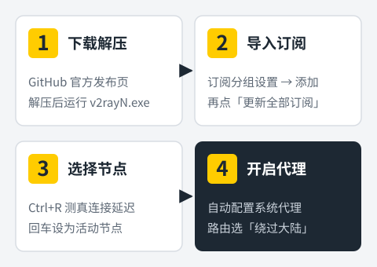
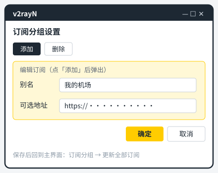
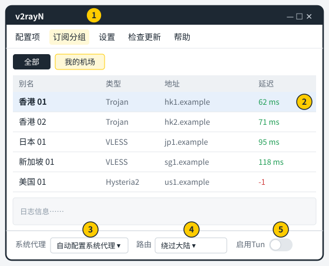
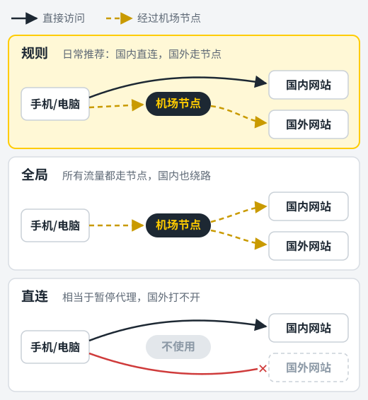

v2rayN 是 Windows 上用了很多年的老牌代理客户端，开源免费，界面是中文。它最大的优点是兼容性好：机场给的通用订阅链接、单个节点链接，几乎都能直接导入。

整个流程分四步：**下载解压 → 导入订阅 → 选择节点 → 开启代理**。下面每一步都写了具体点哪里，以及新手最常踩的坑。

<figure>
  
  <figcaption>整个流程分四步，下面逐步展开。</figcaption>
</figure>

## 准备工作

- **一台 Windows 10 或更新版本的电脑**。
- **一份机场订阅链接**，在机场后台获取，选"通用订阅"或"V2Ray 订阅"。还没有机场的话，可以先看[机场推荐榜单](/jichang-tuijian/)。

## 第一步：下载并运行 v2rayN

### 从官方发布页下载

v2rayN 的作者是 2dust，项目在 GitHub 上公开发布。请到项目的 **Releases** 页面下载，不要用网盘里来历不明的"整合版""绿色版"。代理软件会经手你所有的网络流量，安装包的来源比什么都重要。

### 选对压缩包

Releases 页面每个版本都有好几个文件，Windows 用户只看名字里带 `windows` 的：

| 文件名 | 说明 |
| --- | --- |
| `v2rayN-windows-64.zip` | 普通 64 位电脑，**大多数人选这个** |
| `v2rayN-windows-64-desktop.zip` | 同样是 64 位，换了一套界面框架，功能基本一样 |
| `v2rayN-windows-arm64.zip` | ARM 处理器的 Windows 电脑，比如部分骁龙芯片笔记本 |

标注为 **Pre-release** 的是测试版，日常使用选标注为 **Latest** 的正式版。

### 解压后运行

1. 把压缩包解压到一个固定的文件夹，比如 `D:\Apps\v2rayN`。**不要直接在压缩包里双击运行**，那样配置保存不下来。
2. 文件夹路径里最好不要有中文和空格，可以避开一些莫名其妙的报错。
3. 双击文件夹里的 `v2rayN.exe` 启动。

第一次打开时，如果 Windows 弹出"已保护你的电脑"，点 **更多信息 → 仍要运行**。如果提示缺少 .NET 运行环境，按弹窗里的链接到微软官网安装即可。

v2rayN 不需要安装，整个文件夹就是程序本身。以后换电脑，把整个文件夹拷过去就能继续用，订阅和设置都在里面。

## 第二步：导入机场订阅

<figure>
  
  <figcaption>在「订阅分组设置」里添加订阅：别名随便起，可选地址填订阅链接。</figcaption>
</figure>

<!-- 截图建议：订阅分组设置窗口，订阅链接打码（拿到真实截图后替换上面的示意图） -->

1. 点主界面顶部菜单的 **订阅分组**，选择 **订阅分组设置**。
2. 在弹出的窗口里点 **添加**。
3. **别名** 填机场名字，方便以后区分；**可选地址** 粘贴订阅链接。其他选项保持默认就行。
4. 点 **确定** 保存，关闭设置窗口。
5. 回到主界面，点 **订阅分组 → 更新全部订阅（不通过代理）**。

几秒钟后，节点列表里就会出现机场的全部节点，顶部也会多出一个以别名命名的分组标签。

> 订阅链接相当于你的账号，求助时截图记得打码。

### 只有单个节点链接怎么办

有些机场或朋友只给你一条 `vless://`、`trojan://` 开头的节点链接。复制它，回到 v2rayN 主界面按 **Ctrl+V**，节点就会直接加到列表里。

### 订阅要定期更新

机场换服务器后，旧节点会失效。养成习惯：连不上时先 **更新全部订阅**。也可以在订阅分组设置里打开自动更新，并设置更新间隔。

## 第三步：测速并选择节点

<figure>
  
  <figcaption>① 订阅分组菜单　② 节点列表　③ 系统代理　④ 路由　⑤ 启用 Tun</figcaption>
</figure>

<!-- 截图建议：主界面节点列表与底部状态栏（拿到真实截图后替换上面的示意图） -->

### 测真连接延迟

在节点列表里按 **Ctrl+A** 全选，再按 **Ctrl+R**（或右键菜单里的"测试真连接延迟"）。v2rayN 会通过每个节点实际访问一次网络，把结果写在 **延迟** 一列：

- 显示毫秒数的节点是通的，数字越小响应越快；
- 显示 **-1** 或超时的节点当前不可用，跳过即可。

"真连接延迟"比单纯的 Ping 更能反映实际可用性。有些节点能 Ping 通却上不了网，用这个测试一眼就能看出来。点一下 **延迟** 列的表头，还可以按延迟高低排序。

### 设为活动节点

选中想用的节点，按 **回车**（或右键选择"设为活动"），这一行会高亮显示，表示 v2rayN 正在使用它。

v2rayN 同一时间只用一个活动节点，想换节点就重复这个操作。

## 第四步：开启系统代理

节点选好后，流量还不会自动走代理，需要让 Windows 把网络请求交给 v2rayN。

在主界面底部（或右键右下角托盘图标）找到 **系统代理**，选择 **自动配置系统代理**。托盘图标会变色，表示代理已生效。现在打开浏览器访问国外网站试试。

系统代理的几个选项含义如下：

| 选项 | 作用 |
| --- | --- |
| 自动配置系统代理 | v2rayN 帮你打开 Windows 的系统代理，**日常用这个** |
| 清除系统代理 | 关闭 Windows 的系统代理，相当于暂停 |
| 不改变系统代理 | v2rayN 不动系统设置，适合手动给某个软件配代理的情况 |

## 第五步：路由选「绕过大陆」

底部的 **路由** 决定哪些网站走代理、哪些直连，作用和 Clash 的代理模式一样：

<figure>
  
  <figcaption>v2rayN 的「绕过大陆」对应图中的「规则」，「全局」对应「全局」。</figcaption>
</figure>

- 名字里带 **绕过大陆**（或 Whitelist）的规则：国内网站直连，国外网站走代理，**日常就选它**。
- 名字里带 **全局**（或 Global）的规则：所有流量都走代理，只在排查问题时临时用。

不同版本的规则名称写法略有差别，认准"绕过大陆"这几个字即可。用它的好处是国内网站和下载不受影响，也不浪费机场流量。

## 进阶：Tun 模式

系统代理只对"愿意听系统代理设置"的软件生效，浏览器大多没问题，但命令行工具、部分游戏和桌面软件会绕开它。这时可以用 **Tun 模式**，让 v2rayN 创建一张虚拟网卡，接管电脑上所有程序的流量。

1. 右键 `v2rayN.exe`，选择 **以管理员身份运行**。Tun 模式需要管理员权限才能创建虚拟网卡。
2. 打开底部的 **启用Tun** 开关。
3. 开启 Tun 后，系统代理可以改成"清除系统代理"，两者不需要同时开。

如果只是浏览网页、看视频，用系统代理就够了，不必开 Tun。

## 让 v2rayN 开机自动运行

打开顶部的 **设置** 菜单，进入参数设置（部分版本叫"选项设置"），在常规设置里勾选 **开机自动启动**。配合"自动配置系统代理"，开机后就能直接上网，不用每次手动打开。

## 常见问题排查

**更新订阅失败**
订阅地址可能在当前网络下访问不了。先确认链接完整；还不行就换个网络，或者用机场后台提供的备用订阅地址。

**所有节点延迟都是 -1**
先更新一次订阅，再去机场后台确认套餐没过期、流量没用完。然后检查电脑时间是否准确：右键任务栏时间 → 调整日期和时间 → 立即同步。时间偏差太大会导致部分协议连不上。

**显示已连接，但网页打不开**
确认系统代理选的是"自动配置系统代理"；换一个延迟正常的节点；把路由临时切到"全局"，如果这样能打开，说明是规则没覆盖到，更新一下路由规则就行。

**某个国内网站变慢或打不开**
检查路由是不是选成了"全局"，改回"绕过大陆"。

**退出 v2rayN 后完全上不了网**
系统代理没有被还原。重新打开 v2rayN，选"清除系统代理"后再退出；或者去 Windows **设置 → 网络和 Internet → 代理**，把手动设置代理的开关关掉。

## 小结

v2rayN 用起来就是四件事：**导入订阅并更新、测真连接延迟后回车选节点、系统代理选"自动配置"、路由选"绕过大陆"**。记住这四点，日常使用基本不会出问题。

如果你的机场给的是 Clash 订阅，或者想要更直观的界面，可以改用 [Clash Verge Rev](/jiaocheng/clash-verge-rev-jiaocheng/)。手机端请看 [Shadowrocket 小火箭教程](/jiaocheng/shadowrocket-jiaocheng/)（iPhone）和 [Clash Meta for Android 教程](/jiaocheng/clash-meta-for-android-jiaocheng/)（安卓）。
