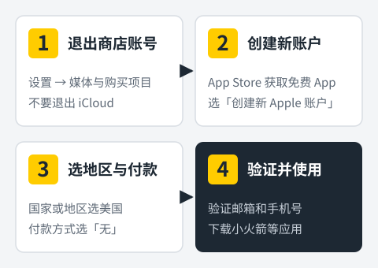
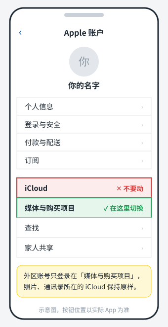

想在 iPhone 上用 Shadowrocket（小火箭）、ChatGPT App，或者下载很多国区商店没有的应用，第一步都是**准备一个外区 Apple ID**。

苹果在 2024 年把"Apple ID"改名为 **"Apple 账户"**，两者是同一个东西，下文会混用这两个叫法。

这篇教程教你**自己注册**一个属于你的外区账号，全程不需要信用卡，大约十分钟。不推荐买现成账号或用别人共享的账号，原因在文末讲。

<figure>
  
  <figcaption>注册流程分四步，下面逐步展开。</figcaption>
</figure>

## 先选地区：美区、港区还是其他

| 地区 | 优点 | 需要注意 |
| --- | --- | --- |
| 美国 | 应用最全，礼品卡渠道最多 | 界面以英文为主 |
| 香港 | 可以显示中文，地址格式熟悉 | 个别应用在港区未上架，比如 ChatGPT |
| 台湾 | 中文界面，应用也比较全 | 礼品卡相对少 |
| 日本 | 适合玩日服游戏 | 界面以日文为主 |

**如果只是为了下载 Shadowrocket，选美区或港区都可以。如果还想装 ChatGPT App，选美区。** 下面以美区为例，其他地区步骤完全一样，只是选择的国家不同。

## 注册前准备三样东西

1. **一个从没注册过 Apple 账户的邮箱。** Gmail、Outlook、QQ 邮箱、163 邮箱都可以。已经绑定国区 Apple ID 的邮箱不能重复使用。
2. **一个能接收短信的手机号。** 用来接收验证码，可以选择 +86 区号使用国内号码。
3. **一个对应地区格式的账单地址。** 美区需要填写美国地址的街道、城市、州和邮编。如果你有在美国的亲友，用真实地址最稳妥。

另外准备好一个**新的强密码**，并记下注册时填写的**出生日期**。以后找回账户时会用到，千万别随手乱填后忘掉。

## 方法一：在 iPhone 的 App Store 里注册（推荐）

这个方法最容易出现付款方式"无"的选项，成功率最高。

### 1. 只退出"媒体与购买项目"

打开 **设置**，点最上方 **你的名字**，进入 Apple 账户页面，点 **媒体与购买项目**，选择 **退出登录**。

<figure>
  
  <figcaption>只在「媒体与购买项目」里退出和登录，iCloud 保持原样。</figcaption>
</figure>

<!-- 截图建议：设置 → 你的名字 页面，圈出媒体与购买项目（拿到真实截图后替换上面的示意图） -->

> **最重要的一条：不要退出 iCloud，也不要在 iCloud 里登录外区账号。** iCloud 关联着你的照片、通讯录、备份和"查找"功能，换掉它既麻烦又有风险。

系统版本不同，入口可能稍有差别。较旧的 iOS 在 **设置 → 你的名字 → 媒体与购买项目** 或 **设置 → App Store** 里退出。

### 2. 从 App Store 发起注册

1. 打开 **App Store**，随便搜索一个**免费应用**，比如"Google"。
2. 点 **获取**，系统会弹出登录框，选择 **创建新 Apple 账户**。
3. 如果点右上角头像后直接出现了"创建新 Apple 账户"，也可以从这里进入。

为什么要从"下载免费应用"进入？因为这样注册时，付款页面更容易出现 **无** 的选项。

### 3. 选择地区并填写账户信息

1. **国家或地区** 选择 **美国（United States）**。这一步一定先改，后面的条款和地址格式都跟着它变。
2. 填写邮箱和密码，同意条款与条件。
3. 填写姓名和出生日期。

### 4. 付款方式选"无"，填写账单地址

在 **付款与配送** 页面：

1. **付款方式** 选择 **无（None）**。
2. 填写账单地址：街道（Street）、城市（City）、州（State）、邮编（Zip）、电话。地址的城市、州和邮编要互相对应。
3. 点 **下一步**。

如果没看到"无"这个选项，先别急，看后面的[常见问题](#常见问题)。

### 5. 验证邮箱和手机号

1. 打开邮箱，把苹果发来的 6 位验证码填进去。没收到就看看垃圾邮件文件夹。
2. 选择手机号的国家区号，输入号码，填写短信验证码。

验证完成后，账户就注册好了。回到 App Store，刚才那个免费应用应该已经可以下载，商店界面也会变成美区。

## 方法二：先在网页注册，再到手机上登录（备用）

方法一如果一直提示"无法创建账户"，可以换这个方法。

1. 用浏览器打开苹果官方的账户网站 `account.apple.com`，点 **创建你的 Apple 账户**。
2. **国家或地区** 选择美国，填写姓名、出生日期、邮箱、密码和手机号。
3. 完成邮箱和手机验证码验证。
4. 回到 iPhone，**设置 → 你的名字 → 媒体与购买项目**，用新账户登录。
5. 打开 App Store 下载一个免费应用。这时会提示"此账户尚未在 App Store 使用过"，点 **检查**，同意条款，付款方式选 **无**，填写账单地址，完成。

网页注册时不会马上要求付款信息，第一次在 App Store 下载时才补填，所以多了第 5 步。

## 注册好之后

### 下载 Shadowrocket 等应用

用外区账户登录 App Store 后，搜索应用名字即可。Shadowrocket 是付费应用，需要先充值，见下一节。安装和使用方法见 [Shadowrocket 小火箭教程](/jiaocheng/shadowrocket-jiaocheng/)。

### 用礼品卡充值，购买付费应用

没有绑定外区信用卡时，购买付费应用要用**对应地区的 App Store 礼品卡**（美区就是美国的 Apple Gift Card）。

1. 购买礼品卡，拿到卡上的兑换码。
2. 打开 App Store，点右上角头像，选择 **兑换充值卡或代码**，输入兑换码。
3. 余额到账后，就能直接购买应用了。

购买礼品卡时**优先选择苹果官方或正规大平台**。价格明显低于面值的卡，可能来路不正，兑换后账户可能被苹果锁定。

### 在国区和外区之间切换

需要更新国区应用、或者用国区账户付款时，按同样的方法切换：**设置 → 你的名字 → 媒体与购买项目 → 退出登录**，再用另一个账户登录。

已经装好的应用不会因为切换账户被删除，照常可以打开使用。更新时，App Store 会提示用当初下载它的那个账户登录。

## 常见问题

### 提示"无法创建账户"或"目前无法完成你的请求"

这是苹果的风控在起作用，常见于短时间内反复尝试注册。处理办法：

1. **停下来，别连续重试**，隔几个小时或第二天再来。
2. 换一个网络环境，例如从 Wi-Fi 换成手机流量。
3. 换用方法二，先在网页注册。

### 付款方式里没有"无"

1. 确认是从 **App Store 下载免费应用** 时发起的注册，而不是先下载付费应用。
2. 先把姓名、地址、电话都填完整，点一下 **下一步**，有时"无"会在之后出现。
3. 还不行，就换一个免费应用重新发起，或改用方法二。

### 收不到手机验证码

确认区号选对了；国内号码偶尔会延迟，等几分钟再点重新发送。多次失败就换个时间或换一个手机号。

### 账户被锁定或需要验证身份

苹果检测到异常登录时，会要求验证身份或重设密码。只要邮箱、手机号、出生日期都是你自己填写并记得的，按提示操作就能解锁。这也是**一定要自己注册**的原因。

## 安全提醒：为什么不要用共享账号

- **共享账号随时可能被收回。** 账号主人改了密码，你下载的应用就没法更新了。
- **有设备被锁的风险。** 如果误把共享账号登录到 iCloud，对方开启"查找"后可以远程锁定你的设备。
- **现成的"成品号"同样不安全。** 卖家手里有注册信息，随时可以找回账户。
- **苹果的条款要求账户地区与使用者的情况相符。** 外区账号请只用来下载应用，不要存放重要数据，也不要和主力账户混用。

自己注册的账户，邮箱、手机号、密码都在你手里，这才是长期安心使用的前提。建议注册后在 **设置 → 你的名字 → 登录与安全** 里检查一下，确认已开启双重认证，进一步保护账户安全。

## 小结

- 准备好三样东西：**未注册过的邮箱、能收验证码的手机号、对应地区的账单地址**。
- 首选 **在 App Store 下载免费应用时注册**，付款方式选"无"；不行就改用网页注册。
- 外区账号**只登录在"媒体与购买项目"**，不要碰 iCloud。

注册好之后，下一步就是安装小火箭：[Shadowrocket 小火箭使用教程](/jiaocheng/shadowrocket-jiaocheng/)。想在手机上用 ChatGPT，可以再看 [ChatGPT 打不开怎么办](/jiaocheng/chatgpt-da-bu-kai/)。
