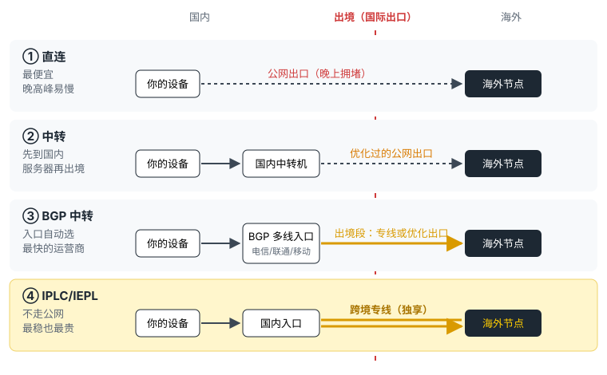

打开任何一家机场的套餐页，都能看到一堆线路名词：直连、中转、BGP、IPLC、IEPL，有的还写"BGP 调度 + 专线出口"。这些词说的其实是同一件事：**你的流量是怎么出境的**。弄懂这一点，再看套餐页就不会被绕晕了。

## 一张图看懂四种线路

<figure>
  
  <figcaption>红色虚线是国际出口。四种线路的差别，主要在流量过这条线的方式。</figcaption>
</figure>

所有翻墙流量都要经过国际出口。国际出口是公共的，晚上全国人都在用，就像下班高峰的过江大桥：桥就这么宽，车多了就堵。不同线路的区别，就是怎么过这座桥。

## 直连：自己开车过桥

你的设备直接连到海外服务器，走的是普通公网出口。

- **好处**：链路最短、成本最低，所以最便宜。
- **问题**：晚高峰和所有人一起挤国际出口，容易变慢、丢包，看视频卡、网页转圈。敏感时期也最容易受影响。
- **适合**：白天偶尔查资料、对速度不敏感，或者海外节点用来做备用。

现在很多机场会把直连节点和其他节点放在一起，名字里通常带"直连"两个字。比如有几家机场的日本、美国、德国节点里，就混着几个标注"直连"的。

## 中转：先到国内的停车场，再统一过桥

你的设备先连到机场放在国内的服务器（中转机），再由它出境到海外节点。

- **好处**：你到中转机这一段在国内，速度快、稳定；中转机出境的线路机场做过优化，比你自己直连稳得多。
- **问题**：出境走的仍然是公网，只是优化过，极端拥堵时一样会受影响。
- **适合**：大多数人。价格和稳定性比较平衡。

## BGP 中转：入口自动挑最顺的路

BGP 中转是中转的升级版。普通中转机可能只接了一家运营商，你用电信、他用移动，体验差别很大。BGP 入口同时接入电信、联通、移动等多条线路，会根据你的网络自动选最快的一条进来。

机场套餐页上常见的"**BGP 调度 + 专线出口**""BGP 多线智能调度 + 专线级出口"，意思是：**入口走 BGP，出境那一段用专线**。

- **好处**：不同运营商的用户体验都比较均匀；出境段是专线的话，晚高峰也比较稳。
- **注意**：它和下面的"全程专线"不是一回事。国内入口这一段并不是专线，整体稳定性一般介于普通中转和全程专线之间。
- **适合**：家里、公司网络运营商不固定的人。

## IPLC / IEPL 专线：机场自己修了一条专用桥

机场向运营商租用跨境专线，从国内入口直通海外节点，流量不和公网一起挤国际出口。

- **好处**：晚高峰和白天差别很小，延迟低、丢包少，看 4K、用 ChatGPT、打游戏、开视频会议都更稳。
- **问题**：专线按带宽收费，成本高，所以同样的价格流量往往更少。
- **适合**：晚上用得多、对稳定性要求高的人。

### IPLC 和 IEPL 差在哪

IPLC（国际私有专线）是传统的点对点电路；IEPL（国际以太网专线）基于以太网技术。实现方式不同，但对用机场的人来说，速度、延迟、能不能看 Netflix，几乎感觉不出区别。

所以挑机场的时候，与其纠结 IPLC 还是 IEPL，不如看这两点：**是不是全部套餐都走专线**，以及**价格和流量是否合理**。

## 四种线路对比

| | 直连 | 中转 | BGP 中转 | IPLC / IEPL 专线 |
| --- | --- | --- | --- | --- |
| 国内入口 | 无 | 单线中转机 | 多线 BGP 入口 | 专线入口 |
| 怎么出境 | 公网 | 优化过的公网 | 优化公网或专线 | 独享跨境专线 |
| 晚高峰 | 容易慢 | 偶尔波动 | 比较稳 | 最稳 |
| 价格 | 最低 | 中等 | 中高 | 最高 |
| 适合 | 偶尔用 | 大多数人 | 运营商不固定 | 晚上重度使用 |

## 直连好还是中转好？

在国内用的话，答案几乎总是**中转好**。直连只有一个优势：便宜。如果你主要在晚上用，或者要看视频、开会，直连那点差价不值得。

反过来，人在海外、只是偶尔需要回连，或者只拿来查查资料，直连就够了。

## 怎么从节点名称看出线路

机场后台和客户端里的节点名称，通常会透露线路类型：

- 名称带 **IPLC、IEPL、专线**：标注为专线节点。
- 名称带 **BGP、三网**：BGP 入口的中转节点。
- 名称带 **中转、精品中转、极速中转**：普通中转。
- 名称带 **直连、CN2**：直连节点（CN2 是电信的一种优质国际线路，常用在直连上）。

同一个套餐里混着几种很正常。比如我们整理时发现，有的机场套餐标注全线专线，后台香港节点却同时分出了"企业专线""BGP 三网""精品中转"几组。用的时候优先选名字带"专线"的节点就行。

## 我们统计的 29 家机场，线路分布是这样的

截至 2026 年 11 月，本站整理的 29 家机场里：

- **22 家**全部套餐都标注 IPLC 或 IEPL 专线；
- **4 家**只有某一档套餐标注专线，其余是 BGP 或中转；
- **3 家**写的是"BGP 调度 + 专线出口"。

具体是哪几家、各自多少钱、哪一档套餐才是专线，都整理在 [IPLC / IEPL 专线机场推荐](/zhuanxian-jichang/) 里。站长主推的 [闪跃](/jichang/shanyue/) 官网标注全 IPLC 专线，所有套餐都一样。

需要提醒的是，"专线"是机场自己的标注，本站还没有逐家测速验证。最可靠的办法还是先买一个月，在你自己的网络下，晚上用一两周看看。

## 接下来可以看

- [机场推荐：29 家机场价格、节点与线路对比](/jichang-tuijian/)
- [IPLC / IEPL 专线机场推荐](/zhuanxian-jichang/)
- [便宜机场推荐](/pianyi-jichang/)
- [机场是什么？订阅、节点、倍率一次讲清](/wenzhang/jichang-shi-shenme/)
